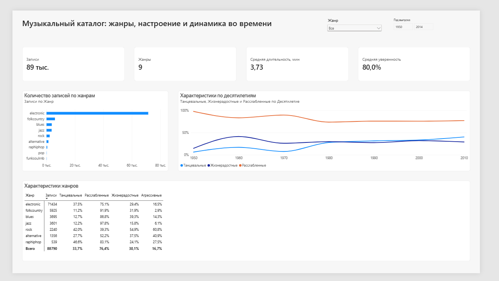
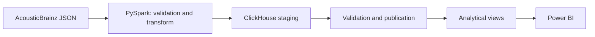

# Music Analytics Pipeline

Учебный ETL/BI-проект для исследования открытых данных AcousticBrainz. Пайплайн преобразует вложенные JSON-документы в проверенный табличный набор данных, загружает его в ClickHouse и предоставляет витрины для интерактивного отчёта Power BI.

Цель исследования: изучить состав музыкальной выборки и связи между жанром, годом выпуска, танцевальностью и настроением записей.

## Результат

В итоговую таблицу загружено 88 816 уникальных записей из 100 000 обработанных JSON-документов. Для анализа используются девять непустых жанров, длительность записей, год выпуска и результаты классификаторов AcousticBrainz.



Дашборд показывает:

- объём и жанровый состав выборки;
- среднюю длительность и уверенность определения жанра;
- доли танцевальных, жизнерадостных, расслабленных и агрессивных записей по жанрам;
- изменение характеристик записей по десятилетиям;
- фильтрацию результатов по жанру и году выпуска.

В выборке преобладает жанр `electronic` — он составляет около 80% записей. Поэтому сравнения между жанрами следует интерпретировать как описание этой выборки, без переноса выводов на всю музыку.

## Архитектура



PySpark читает JSON по явной схеме, приводит вложенные поля к табличному виду и проверяет идентификаторы, вероятности и дубликаты. Данные сначала записываются в staging-таблицу ClickHouse. Отдельный шаг проверяет загрузку и идемпотентно публикует её в основную таблицу.

Для аналитики подготовлены три представления:

- `v_recording_overview` — записи и их характеристики;
- `v_genre_summary` — агрегированные показатели по жанрам;
- `v_data_quality_summary` — пропуски, некорректные годы и низкая уверенность классификации.

## Структура проекта

```text
.
├── .github/workflows/       # проверки в GitHub Actions
├── docs/                    # изображения отчёта
├── docker/                  # образ ETL
├── powerbi/                 # PBIP-отчёт и семантическая модель
├── sql/init/                # схема ClickHouse и аналитические представления
├── src/                     # загрузка, преобразование и публикация данных
├── tests/                   # модульные тесты
├── docker-compose.yml
└── requirements.txt
```

## Запуск

Понадобятся Docker с поддержкой Compose, Power BI Desktop и драйвер ClickHouse для подключения Power BI.

Соберите ETL-образ и запустите ClickHouse:

```bash
docker compose build etl
docker compose up -d clickhouse
```

Скачайте официальный high-level sample AcousticBrainz и распакуйте его:

```bash
docker compose run --rm etl python src/download_data.py
docker compose run --rm etl sh -c "mkdir -p data/raw/highlevel && tar --use-compress-program=unzstd -xf data/raw/archives/acousticbrainz-highlevel-sample-json-20220623-0.tar.zst -C data/raw/highlevel"
```

Для быстрой проверки обработайте 1 000 документов:

```bash
docker compose run --rm etl python src/transform_highlevel.py \
  --input data/raw/highlevel \
  --limit 1000 \
  --show 0 \
  --write-clickhouse \
  --load-id sample-1000

docker compose run --rm etl python src/publish_staging.py sample-1000
```

Для полной обработки sample удалите параметр `--limit` и задайте новый `load-id`, например `sample-full`. Повторная публикация одного `load-id` безопасно пропускается.

После загрузки данных откройте `powerbi/music_catalog_analysis.pbip` и обновите модель. ClickHouse доступен на `localhost:8123`, база данных — `music`.

Остановить сервисы:

```bash
docker compose down
```

## Проверки

GitHub Actions при каждом push и pull request:

- проверяет синтаксис Python;
- запускает модульные тесты;
- валидирует конфигурацию Docker Compose.

Локальный запуск:

```bash
python -m unittest discover -s tests -p "test_*.py"
docker compose config --quiet
```

## Ограничения

- sample AcousticBrainz не является репрезентативной выборкой всей музыки;
- значения вероятности отражают уверенность исходных моделей классификации;
- 1 608 записей не имеют года выпуска, ещё 40 содержат год вне диапазона 1900–2026;
- источник статичен, поэтому пайплайн запускается вручную.
