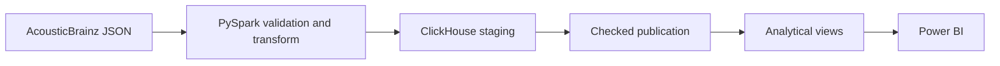

# Music Analytics Pipeline

Учебный ETL/BI-проект для подготовки публичных данных AcousticBrainz к анализу
в Power BI. Пайплайн преобразует вложенные JSON-документы в проверенный набор
данных и витрины ClickHouse.

Цель отчёта — помочь аналитику оценить состав музыкального каталога, полноту
метаданных и уверенность автоматической классификации жанров.

ETL-часть проекта работает сквозным образом. Отчёт Power BI находится в
процессе подготовки.

## Результат

Для отчёта Power BI подготовлены три представления:

- `v_recording_overview` — записи и их характеристики;
- `v_genre_summary` — показатели состава и качества по жанрам;
- `v_data_quality_summary` — общие показатели пропусков и низкой уверенности.

На одной странице отчёта достаточно показать количество записей, долю
пропущенных метаданных, долю классификаций с низкой уверенностью, распределение
по жанрам и таблицу проблемных жанров.

<!--
После завершения отчёта экспортируйте его в docs/dashboard.png и
docs/dashboard.pdf, затем добавьте сюда:


-->

## Архитектура



PySpark читает JSON по явной схеме, приводит вложенные поля к табличному виду и
проверяет идентификаторы и дубликаты. Результат загружается во временную таблицу
ClickHouse. Отдельный шаг проверяет загрузку и публикует её в основную таблицу.

## Что реализовано

- загрузка официального high-level sample с проверкой SHA-256;
- исследование полей и типов JSON на выборке;
- преобразование данных по явной схеме PySpark;
- проверки MBID, вероятностей и дубликатов;
- staging-слой и идемпотентная публикация в ClickHouse;
- подробная и агрегированные аналитические витрины;
- воспроизводимое окружение Docker Compose.

## Запуск

Требуется Docker с поддержкой Compose. При необходимости скопируйте
`.env.example` в `.env` и замените демонстрационный пароль ClickHouse.

Соберите ETL-образ и запустите ClickHouse:

```bash
docker compose build etl
docker compose up -d clickhouse
```

Скачайте и распакуйте официальный high-level sample:

```bash
docker compose run --rm etl python src/download_data.py
docker compose run --rm etl sh -c "mkdir -p data/raw/highlevel && tar --use-compress-program=unzstd -xf data/raw/archives/acousticbrainz-highlevel-sample-json-20220623-0.tar.zst -C data/raw/highlevel"
```

Обработайте данные и загрузите их в staging. Для быстрой проверки можно
ограничить число документов параметром `--limit`:

```bash
docker compose run --rm etl python src/transform_highlevel.py \
  --input data/raw/highlevel \
  --limit 1000 \
  --show 0 \
  --write-clickhouse \
  --load-id sample-1000
```

Опубликуйте проверенную загрузку:

```bash
docker compose run --rm etl python src/publish_staging.py sample-1000
```

Повторная публикация того же `load_id` безопасно пропускается. Для новой
загрузки задайте новый идентификатор.

Остановить сервисы можно командой:

```bash
docker compose down
```

## Подключение Power BI

После запуска ClickHouse доступен на `localhost:8123`, база — `music`. Для
отчёта используются представления `v_recording_overview`, `v_genre_summary` и
`v_data_quality_summary`. Значения ключевых показателей следует сверить с
запросами к тем же представлениям перед экспортом отчёта.

Файлы `.pbix` и `.pbit` можно хранить в каталоге `powerbi/`. Для просмотра без
Power BI Desktop добавьте в `docs/` скриншот и PDF-экспорт отчёта.

## Ограничения

- sample AcousticBrainz не является репрезентативной выборкой всей музыки;
- probability отражает уверенность модели классификации;
- порог низкой уверенности `0.5` выбран для демонстрационного анализа;
- источник статичен, поэтому запуск выполняется вручную.
